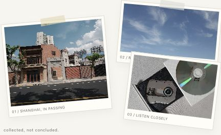
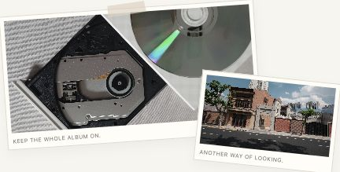

BCZ / PERSONAL ARCHIVE · EST. 2026

<h1>  
  <picture>  
    <source media="(prefers-color-scheme: dark)" srcset="assets/archive-title-dark.png">  
      
  </picture>  
</h1>

一些作品，一些日常，一些还没想明白的事。

<picture>  
  <source media="(prefers-color-scheme: dark)" srcset="assets/hero-archive-dark.png">  
    
</picture>

---

## ABOUT ME / 01

**杨航 / bcz**  
本科在读 · 上海，中国

金融学 
音乐、城市、互联网与产品设计

我喜欢琢磨产品为什么这样设计，也喜欢从日常生活里发现值得解决的问题。

比起一直停留在想法阶段，我更享受把它们做成真正可以体验的东西。

这里记录着我的项目、尝试，以及还在不断修改的想法。

---

## SIDE A / THINGS I'VE MADE

从一个问题开始，慢慢做出自己的答案。

### 01 / Truth Detective

AI 辅助推理游戏，围绕证据、信息判断与批判性思维展开，探索 AI 如何帮助用户审视自己的推理，而非直接提供答案。

AI & REASONING / INTERACTIVE GAME

**[Try it! ↗](https://truth-detective-07655.app.workbuddy.host/)** · [Source ↗](https://github.com/yanghang-bcz/truth-detective)

---

### 02 / CalcDaily

面向考研高等数学的自适应练习工具，根据用户表现调整题目难度、追踪知识点掌握情况，并提供错题复习机制。

ADAPTIVE LEARNING / MATHEMATICS

**[Try it! ↗](https://calcdaily.cn/)** · [Source ↗](https://github.com/yanghang-bcz/math-practice-demo)

---

### 03 / Campus Pulse

AI 辅助校园反馈平台，帮助学校整理、聚合和理解学生意见，降低重复信息处理负担。

研究原型，公开演示使用模拟数据。截图为仓库存档的 v0.5.1 总览。

STUDENT VOICES / HUMAN JUDGMENT

**[Try it! ↗](https://campus-pulse.app.workbuddy.host/)** · [Source ↗](https://github.com/yanghang-bcz/campus-pulse)

---

### 04 / FinModel Lab

交互式金融建模教学平台，通过模型可视化、参数调整和可执行 R 代码，帮助学生理解金融模型及其数学逻辑。

FINANCIAL MODELLING / LEARNING WITH R

**[Try it! ↗](https://finmodel-lab.app.workbuddy.host/?sharecode=PLWKCGJYNW)** · [Source ↗](https://github.com/yanghang-bcz/finmodel-lab)

---

## SIDE B / LINER NOTES

音乐占据了我生活里相当大的一部分。

我喜欢完整地听一张专辑，也喜欢反复琢磨一个编曲细节。

除了音乐，我也对城市、人类行为、经济学，以及技术如何改变日常生活充满好奇。

<picture>  
  <source media="(prefers-color-scheme: dark)" srcset="assets/liner-photos-dark.png">  
    
</picture>

### CURRENTLY LISTENING

- **Sweet Trip** — *Velocity : Design : Comfort*
- **Porter Robinson** — *Nurture*
- **Ichiko Aoba** — *Windswept Adan*

---

*still learning. still listening. still making things.*

BCZ / SHANGHAI / 2026
