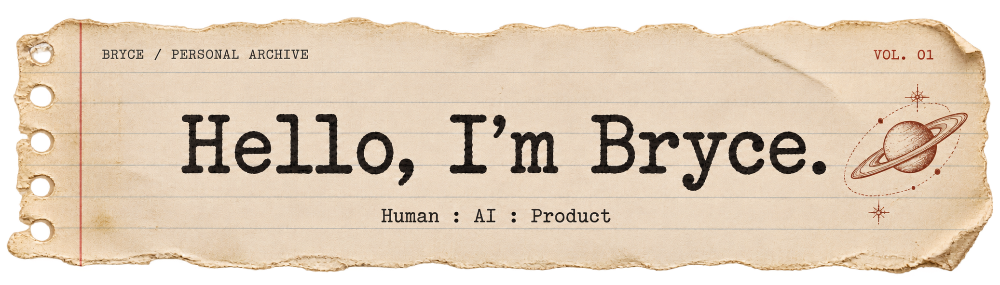

<p align="center">
  
</p>

<h3 align="center">保持思考，保持创新，保持爱</h3>

<p align="center">
  <a href="PORTFOLIO.md"></a>
  <a href="https://github.com/yanghang-bcz?tab=repositories"></a>
</p>

<p align="center"><sub>Portfolio 链接待补充 · 仓库入口已就绪</sub></p>

<sub>identity.txt</sub>

```text
Name:  杨航 / Bryce
MBTI:  ENFJ
Base:  Shanghai
Email: 17375051324@163.com
```

## 01 / About

你好，我是杨航，也叫 Bryce，上海对外经贸大学金融学本科在读。

我关心人如何理解信息、做出判断，也对 AI 能怎样融入学习和日常生活保持好奇。做产品对我来说，是把这些问题变成可以体验、可以讨论、也可以不断修改的东西。

这里存放着我的作品，以及一些仍在生长的想法。希望它们有用，也希望它们保留一点属于人的温度。

## 02 / Selected Works

从一个具体的问题开始，给想法一个可以被看见的形状。

<table>
  <tr>
    <td width="50%" valign="top">
      <sub>FILE 001 / AI &amp; REASONING</sub>
      <h3>Truth Detective</h3>
      <p>一款围绕证据调查与信息判断展开的 AI 辅助推理游戏。比较线索，审视第一判断，再回到证据本身。</p>
      <p><sub>Case 001 · 可玩原型</sub></p>
      <p><a href="https://truth-detective-07655.app.workbuddy.host/">在线试玩 ↗</a> · <a href="https://github.com/yanghang-bcz/truth-detective">Repository ↗</a></p>
    </td>
    <td width="50%" valign="top">
      <sub>FILE 002 / ADAPTIVE LEARNING</sub>
      <h3>CalcDaily</h3>
      <p>从自己的考研复习出发，做一个自适应高数练习网站。结合难度调整、AI 出题、数学校验与错题复习。</p>
      <p><sub>已上线 · 持续迭代</sub></p>
      <p><a href="https://calcdaily.cn/">在线练习 ↗</a> · <a href="https://github.com/yanghang-bcz/math-practice-demo">Repository ↗</a></p>
    </td>
  </tr>
  <tr>
    <td width="50%" valign="top">
      <sub>FILE 003 / CAMPUS &amp; FEEDBACK</sub>
      <h3>Campus Pulse</h3>
      <p>让校园反馈更容易被整理和理解。AI 聚合相似意见，保留回到原始声音的路径，由人作出判断。</p>
      <p><sub>研究原型 · 合成数据只读演示</sub></p>
      <p><a href="https://campus-pulse.app.workbuddy.host/">查看演示 ↗</a> · <a href="https://github.com/yanghang-bcz/campus-pulse">Repository ↗</a></p>
    </td>
    <td width="50%" valign="top">
      <sub>FILE 004 / MODELS &amp; INTUITION</sub>
      <h3>FinModel Lab</h3>
      <p>连接金融模型、交互图表与可执行 R 代码的教学工作台。调一调参数，让公式、假设与计算过程更直观。</p>
      <p><sub>六个核心实验 · 待课堂试用</sub></p>
      <p><a href="https://finmodel-lab.app.workbuddy.host/?sharecode=PLWKCGJYNW">在线体验 ↗</a> · <a href="https://github.com/yanghang-bcz/finmodel-lab">Repository ↗</a></p>
    </td>
  </tr>
</table>

## 03 / Field Notes

- **正在探索**：AI 产品、学习工具，以及技术与人的关系。
- **做事的方式**：先理解问题，再做出原型，在真实的使用和反馈里继续修改。
- **欢迎交流**：产品想法、使用体验，或者一个值得一起琢磨的问题。

[写信给我 ↗](mailto:17375051324@163.com) · [查看所有仓库 ↗](https://github.com/yanghang-bcz?tab=repositories)

---

<p align="center"><sub>BRYCE / SHANGHAI<br>Keep thinking. Keep creating. Keep loving.</sub></p>

<p align="center"><sub><a href="ASSET-CREDITS.md">图像与来源</a></sub></p>
